 

  <picture>
    <source media="(prefers-color-scheme: dark)" srcset="https://github.com/IshanJ25/IshanJ25/blob/main/dark_sign.svg" width="600">
    <source media="(prefers-color-scheme: light)" srcset="https://github.com/IshanJ25/IshanJ25/blob/main/light_sign.svg" width="600">
    
  </picture>

# 💫 About Me

- 👨‍💻 Software developer who enjoys turning ideas into reality.
- 🎓 Final-Year CSE undergrad at VIT, Vellore.
- 💻 Interested in full-stack development, mobile applications, and software engineering.
- 🤖 Fascinated by the intersection of software and hardware, especially robotics and embedded systems.
- 🎨 Equally passionate about graphic design, UI/UX, motion graphics, and creative technology.
- 🧩 Always experimenting with side projects, exploring new technologies, and breaking things to understand how they work.

## 🛠️ Tech Stack

**Languages & Databases**

**Frameworks & Development**

**Tools & Creative Software**

## 🐍 GitHub Contribution

  <picture>
    <source media="(prefers-color-scheme: dark)" srcset="https://github.com/IshanJ25/IshanJ25/blob/output/snek_dark.svg">
    <source media="(prefers-color-scheme: light)" srcset="https://github.com/IshanJ25/IshanJ25/blob/output/snek_light.svg">
    
  </picture>

  

---

  

